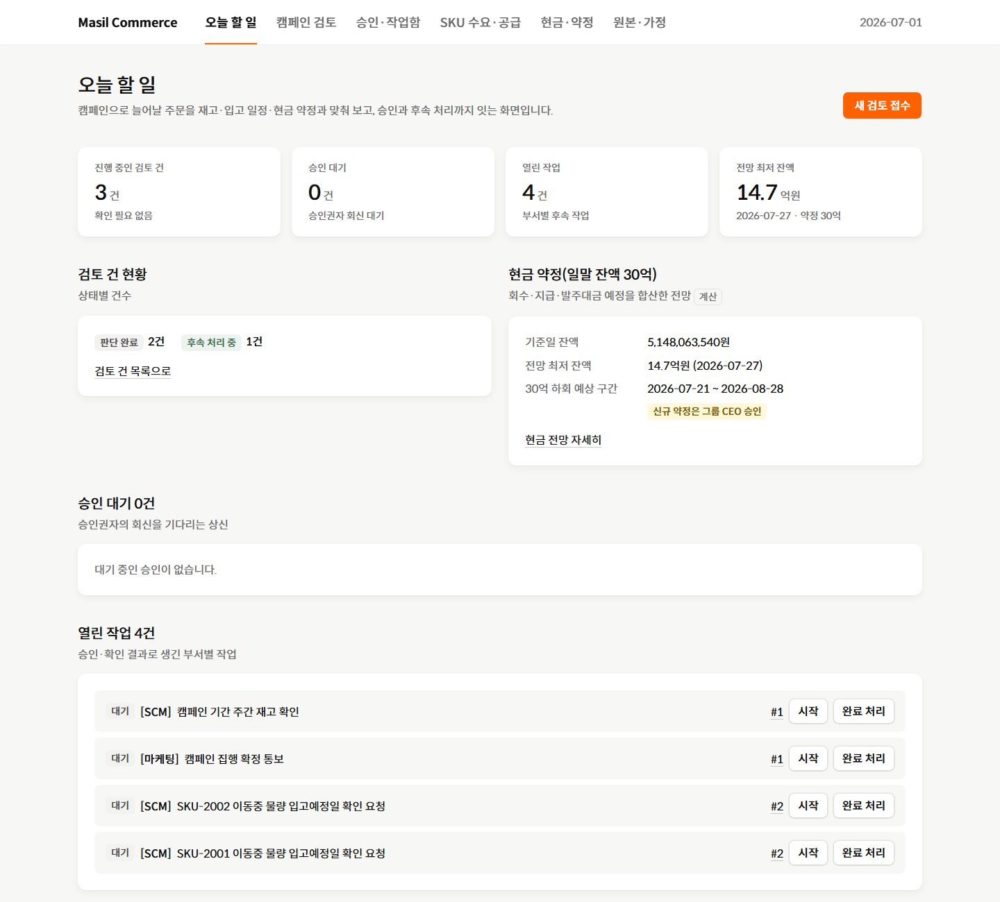
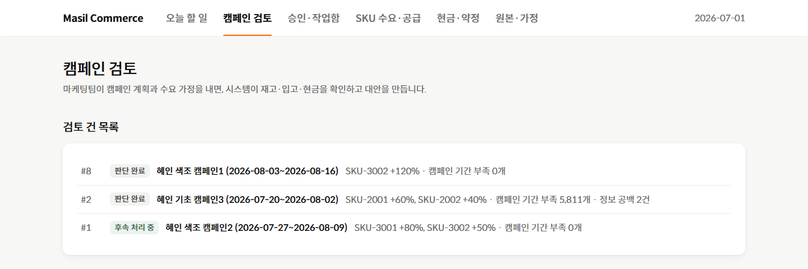
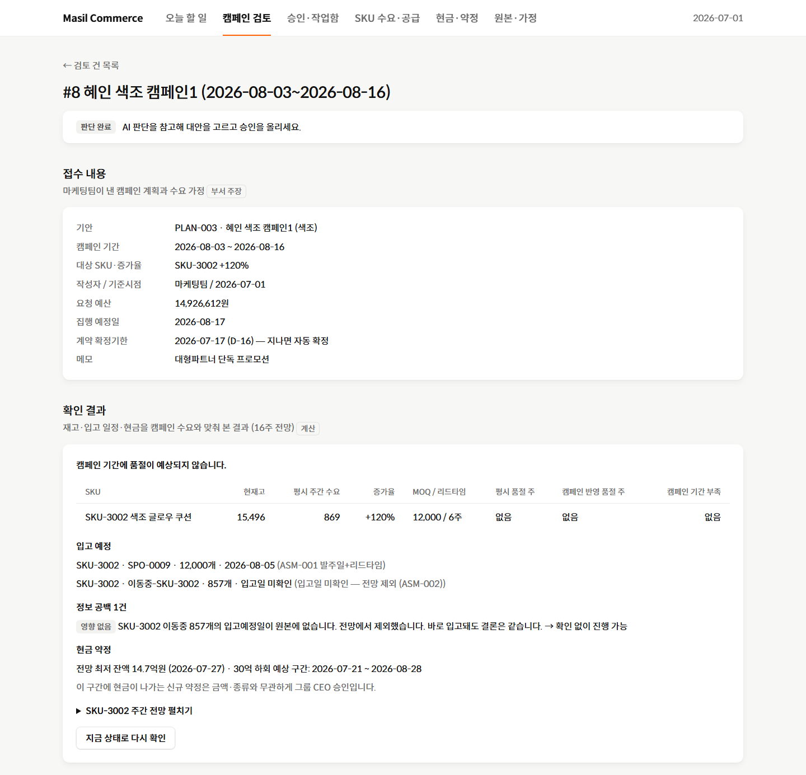
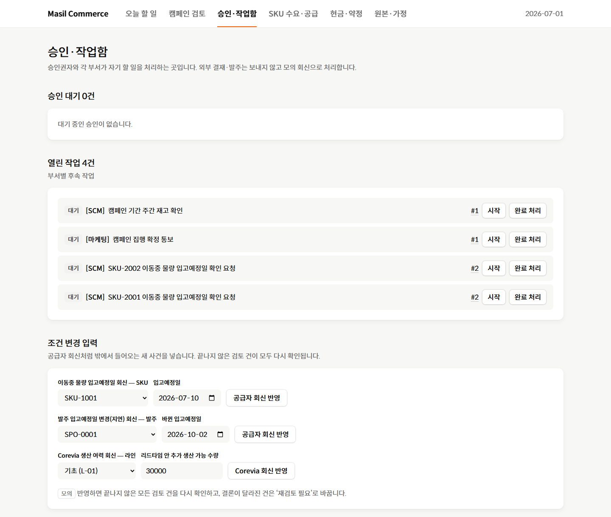
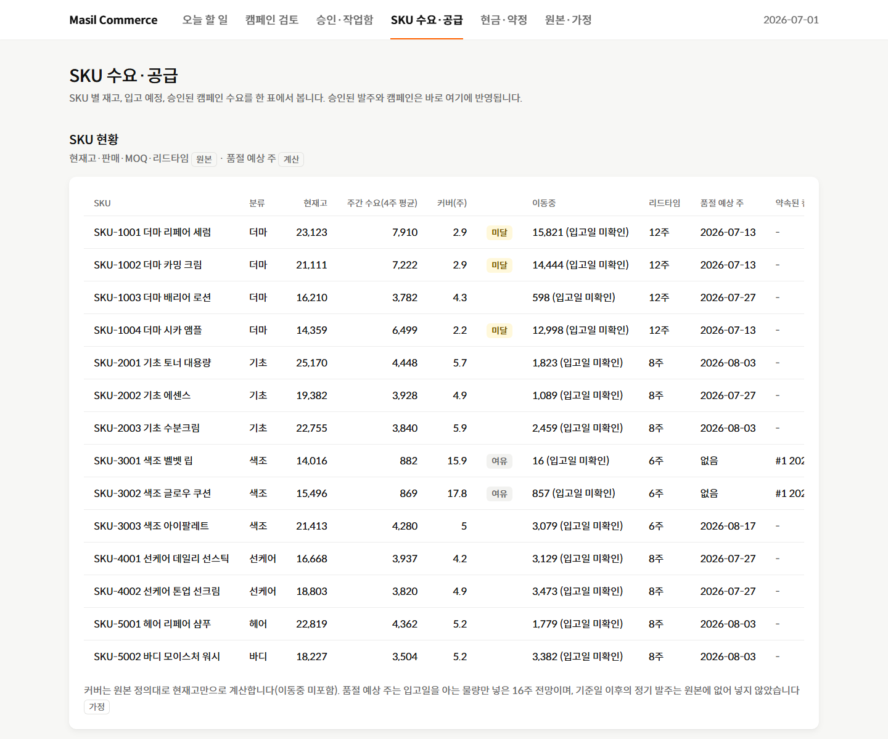
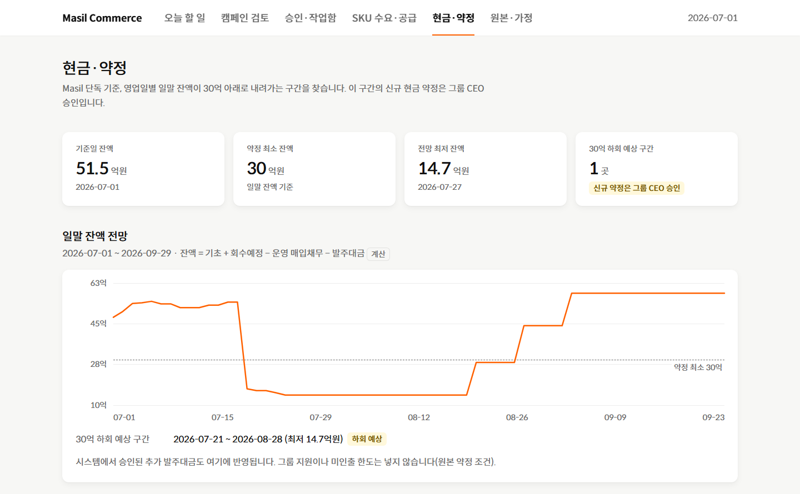
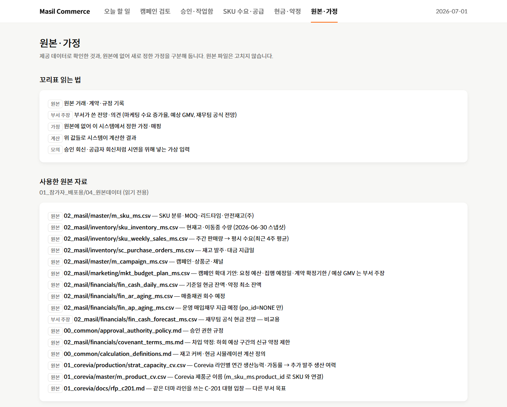

<div align="center">

# Masil Commerce 운영 시스템

### 캠페인 수요와 공급 일정을 맞추는 AI 운영 시스템

### 캠페인 접수부터 재고·입고·현금 확인, AI 판단, 승인, 후속 처리까지 한 흐름으로

<br/>



<br/>
<br/>


<br/>

#### AX 인재전쟁 ONLINE · 삼일PwC 대회 · 1인 프로젝트

</div>

<br/>

## 📑 목차

<div align="center">

<a href="#1-프로젝트-소개">💻 프로젝트 소개</a> &nbsp;·&nbsp;
<a href="#2-기획-배경">💡 기획 배경</a> &nbsp;·&nbsp;
<a href="#3-주요-기능">✨ 주요 기능</a> &nbsp;·&nbsp;
<a href="#4-업무-흐름">🔄 업무 흐름</a> &nbsp;·&nbsp;
<a href="#5-ai-활용">🤖 AI 활용</a>
<br/>
<a href="#6-기술-스택">🛠 기술 스택</a> &nbsp;·&nbsp;
<a href="#7-시스템-아키텍처">🏗 시스템 아키텍처</a> &nbsp;·&nbsp;
<a href="#8-프로젝트-구조">📂 프로젝트 구조</a> &nbsp;·&nbsp;
<a href="#9-api-명세">📋 API 명세</a> &nbsp;·&nbsp;
<a href="#10-시작하기">🚀 시작하기</a>

</div>

<br/>

<a id="1-프로젝트-소개"></a>

## 💻 1. 프로젝트 소개

> **마케팅 캠페인이 만들 주문을 재고·입고 일정·현금 약정과 맞춰 보고, 승인과 후속 처리까지 잇는 운영 시스템**

Aurora 그룹(가상 화장품 그룹)의 유통 자회사 **Masil Commerce** 를 무대로 합니다. 기준일 **2026-07-01** 에 마케팅팀이 캠페인 계획을 내면, 시스템이 SKU 별 재고와 입고 예정, 영업일별 현금 잔액을 계산해 대안을 만듭니다. AI가 그 결과를 근거로 판단 초안을 쓰면, 담당자가 승인권자에게 상신하고 승인 뒤 부서별 후속 작업이 이어집니다.

| 항목 | 상세 내용 |
|:---:|:---|
| 🗓️ **개발 기간** | 2026.11.11 ~ 진행 중 |
| 💻 **플랫폼** | Web |
| 👥 **개발 인원** | 1명 (1인 프로젝트 · 기획 · 화면 · 백엔드 · AI · 배포 전담) |
| 🏢 **대회** | AX 인재전쟁 ONLINE · 삼일PwC |
| 🌐 **배포** | AXHub (`aurora-hyeonji`) |

<br/>

<a id="2-기획-배경"></a>

## 💡 2. 기획 배경

캠페인 하나를 열 때 부서마다 보는 숫자가 다릅니다.

- **마케팅팀은 수요만 봅니다.** 증가율과 예상 GMV는 내지만, 그만큼의 재고가 언제 들어오는지는 따로 확인해야 합니다.
- **SCM은 리드타임과 MOQ에 묶여 있습니다.** 추가 발주를 하려면 Corevia 생산 라인 여력을 먼저 확인해야 하고, 같은 라인을 쓰는 다른 수요와도 부딪힙니다.
- **재무팀은 차입 약정을 지켜야 합니다.** 영업일별 일말 잔액이 30억 아래로 내려가는 구간에서 새로 현금을 쓰려면 그룹 CEO 승인이 필요합니다.
- **조건은 계속 바뀝니다.** 공급자 입고 회신이나 수요 정정이 들어오면 앞서 낸 판단을 처음부터 다시 맞춰 봐야 합니다.

**Masil Commerce 운영 시스템은 이 숫자들을 한 화면에 모읍니다.** 계산은 시스템이 하고, AI는 계산된 근거만으로 판단 초안을 쓰고, 사람은 승인과 후속 처리에 집중합니다.

<br/>

<a id="3-주요-기능"></a>

## ✨ 3. 주요 기능

### 오늘 할 일

<p align="left">진행 중인 검토 건, 승인 대기, 열린 작업, 전망 최저 잔액을 첫 화면에서 확인합니다. 현금 약정(일말 잔액 30억)을 밑도는 구간이 있으면 바로 알려 줍니다. (맨 위 이미지)</p>

<br/>

### 캠페인 검토

<p align="left">마케팅팀이 캠페인 기안과 SKU 별 수요 증가율을 접수하면, 검토 건마다 상태(판단 완료·후속 처리 중 등)와 캠페인 기간 부족 수량, 정보 공백을 목록으로 보여 줍니다.</p>

<div align="center">

</div>

<br/>

### 검토 건 상세 · 확인 결과

<p align="left">접수 내용(부서 주장)과 시스템 계산 결과를 나눠 보여 줍니다. SKU 별 현재고·평시 수요·MOQ·리드타임·품절 예상 주, 입고 예정, 정보 공백, 현금 약정 영향을 한 번에 확인하고 AI 판단과 대안 선택으로 넘어갑니다.</p>

<div align="center">

</div>

<br/>

### 승인·작업함

<p align="left">승인권자의 회신과 부서별 후속 작업을 처리합니다. 공급자 입고예정일 회신, 발주 지연, Corevia 생산 여력 회신 같은 조건 변경을 넣으면 끝나지 않은 검토 건을 모두 다시 확인합니다.</p>

<div align="center">

</div>

<br/>

### SKU 수요·공급

<p align="left">SKU 별 현재고, 주간 수요, 커버 주수, 이동중 수량, 리드타임, 품절 예상 주를 한 표에서 봅니다. 승인된 발주와 캠페인 수요가 바로 반영됩니다.</p>

<div align="center">

</div>

<br/>

### 현금·약정

<p align="left">영업일별 일말 잔액 전망을 그래프로 보여 주고, 약정 최소 잔액 30억 아래로 내려가는 구간을 표시합니다. 재무팀 공식 전망과도 비교합니다.</p>

<div align="center">

</div>

<br/>

### 원본·가정

<p align="left">원본·부서 주장·가정·계산·모의 꼬리표로 근거의 성격을 구분하고, 사용한 원본 파일과 새로 정한 가정·매핑을 모두 공개합니다.</p>

<div align="center">

</div>

<br/>

### 그 밖의 기능

- **대안 자동 생성**: 추가 발주, 일정 조정 등 여러 대안을 만들고 각각의 승인권자와 실행 가능 여부를 계산합니다.
- **승인 경로 계산**: 승인 권한 규정에 따라 대안마다 승인권자를 정합니다.
- **조건 변경 재확인**: 공급자 입고 회신·Corevia 생산 여력 회신·수요 정정이 들어오면 끝나지 않은 검토 건을 모두 다시 확인합니다.
- **모의 회신**: 외부 결재·발주는 실제로 보내지 않고 모의 회신으로 처리합니다.

<br/>

<a id="4-업무-흐름"></a>

## 🔄 4. 업무 흐름

```
접수 → 확인 → AI 판단 → 승인 상신 → 승인 회신 → 후속 처리 → 완료
          ↑______ 조건 변경(공급자 회신·수요 정정)이 들어오면 다시 확인 ______|
```

| 단계 | 내용 |
| --- | --- |
| **접수** | 마케팅팀이 캠페인 계획과 수요 증가율을 냅니다 |
| **확인** | SKU 별 재고·입고 예정·현금 잔액을 계산하고 대안을 만듭니다. 리드타임·MOQ·Corevia 생산 여력·일말 잔액 30억 약정을 제약으로 넣습니다 |
| **AI 판단** | Claude가 계산 결과만 근거로 어떤 대안을 올릴지 초안을 씁니다 |
| **승인** | 승인권자가 승인·거절합니다. 거절되면 대안을 다시 검토합니다 |
| **후속 처리** | 부서별 작업이 생기고, 승인된 발주와 캠페인 수요가 다음 계산에 반영됩니다 |

모든 상태는 DB(`tasks`, `events`)에 남고, 다음 확인 때 계산 엔진의 입력으로 다시 쓰입니다.

<br/>

<a id="5-ai-활용"></a>

## 🤖 5. AI 활용

AI는 **계산하지 않고 판단만** 합니다. 숫자는 모두 시스템이 계산한 값이고, AI는 그 근거를 읽고 어떤 대안을 올릴지 초안을 씁니다.

| 원칙 | 내용 |
| --- | --- |
| 🔢 **숫자를 지어내지 않음** | 받은 근거에 있는 숫자만 인용합니다 |
| 🏷️ **근거 성격 구분** | 원본 기록은 `fact`, 부서 주장은 `claim`, 새로 정한 가정은 `assumption`, 시스템 계산은 `calculation` 으로 나눕니다 |
| 🚧 **원본 제약 유지** | 리드타임·MOQ·승인 권한·차입 약정을 없다고 가정하지 않습니다 |
| ⏸️ **정보 공백이면 보류** | 판단을 바꿀 수 있는 공백이 있으면 `missing_info` 에 적고 `hold` 로 둡니다 |
| 🔁 **이전 결정 반영** | 거절된 대안과 승인권자가 붙인 조건을 다음 판단에 반영합니다 |

- 모델: `claude-opus-5-5` (`ANTHROPIC_MODEL`, `AI_EFFORT` 로 바꿀 수 있음)
- API 키가 없으면 규칙 기반 예비 판단으로 동작합니다.
- 프롬프트: [`backend/app/prompts/`](backend/app/prompts/)

<br/>

<a id="6-기술-스택"></a>

## 🛠️ 6. 기술 스택

<div align="center">

### Frontend


<table>
<tr><th>Category</th><th>Stack</th></tr>
<tr><td>Language</td><td>TypeScript 5</td></tr>
<tr><td>Framework</td><td>Next.js 16 (App Router, 정적 내보내기), React 19</td></tr>
<tr><td>Styling</td><td>Tailwind CSS 4, shadcn/ui</td></tr>
<tr><td>Package Manager</td><td>pnpm</td></tr>
</table>

<br/>

### Backend


<table>
<tr><th>Category</th><th>Stack</th></tr>
<tr><td>Language</td><td>Python 3.11</td></tr>
<tr><td>Framework</td><td>FastAPI 0.162, uvicorn 0.54</td></tr>
<tr><td>ORM / Migration</td><td>SQLAlchemy 2.1, Alembic 1.20</td></tr>
<tr><td>Validation / Settings</td><td>Pydantic 2.14, pydantic-settings</td></tr>
<tr><td>Data</td><td>pandas 3.1 (원본 CSV 읽기·계산)</td></tr>
<tr><td>Test</td><td>pytest 9.2, httpx</td></tr>
</table>

<br/>

### AI · Infra


<table>
<tr><th>Category</th><th>Stack</th></tr>
<tr><td>AI</td><td>Anthropic SDK 2.8, claude-opus-5-5</td></tr>
<tr><td>Database</td><td>PostgreSQL (배포), SQLite (로컬)</td></tr>
<tr><td>Deploy</td><td>Docker 멀티 스테이지 빌드, AXHub</td></tr>
</table>

</div>

<br/>

<a id="7-시스템-아키텍처"></a>

## 🏗️ 7. 시스템 아키텍처

화면과 백엔드를 **컨테이너 하나**로 묶어 배포합니다. Next.js를 정적 파일로 빌드한 뒤 FastAPI가 화면과 API를 함께 내보냅니다.

```
                       ┌──────────────── Docker 컨테이너 (AXHub) ────────────────┐
                       │                                                         │
  브라우저 ──────────▶ │  FastAPI ── /            → Next.js 정적 화면 (out/)      │
                       │          ── /api/v1/...  → endpoints                    │
                       │          ── /healthz     → 상태 확인                    │
                       │                 │                                       │
                       │      services (계산 · 업무 흐름 · AI 판단) ─────────────┼──▶ Claude API
                       │                 │                                       │
                       │      repositories ──┬── PostgreSQL (tasks, events)      │
                       │                     ├── 원본 CSV (읽기 전용)            │
                       │                     └── 가정 데이터 (data/assumptions)  │
                       └─────────────────────────────────────────────────────────┘
```

백엔드는 `api → services → repositories → models/db` 한 방향으로만 부릅니다. 저장(commit)은 엔드포인트에서 한 번만 합니다.

<br/>

<a id="8-프로젝트-구조"></a>

## 📂 8. 프로젝트 구조

```
.
├── 01_참가자_배포용/          # 대회 원본 문제·데이터 (읽기 전용)
│   └── 04_원본데이터/          # Masil · Corevia · Aurora 그룹 · 외부 데이터
├── data/
│   └── assumptions/           # 원본에 없어 새로 정한 가정·매핑 (ASM-*, MAP-*)
├── backend/
│   ├── app/
│   │   ├── main.py            # FastAPI 시작점, 정적 화면 연결, /healthz
│   │   ├── api/v1/endpoints/  # cases · approvals · work · changes · supply · cash …
│   │   ├── schemas/           # 요청·응답 형식 (Pydantic)
│   │   ├── services/          # 재고·생산 여력·현금 계산, 업무 흐름, 승인 경로, AI 판단
│   │   ├── repositories/      # DB CRUD, 원본 CSV·가정 데이터 읽기
│   │   ├── models/            # tasks, events 테이블
│   │   ├── core/              # 설정, AI 클라이언트, 영업일 계산
│   │   └── prompts/           # AI 판단 프롬프트
│   ├── alembic/               # DB 마이그레이션
│   └── tests/                 # 기능별 테스트
├── frontend/
│   └── src/
│       ├── app/               # 오늘 할 일 · cases · work · supply · cash · data
│       ├── components/        # ui(shadcn) · common · 업무별 조각
│       ├── hooks/             # useApi, useAction
│       ├── lib/               # API 호출, 표시 형식, 라벨
│       └── types/             # 기능별 타입
├── Dockerfile                 # 화면 빌드 → FastAPI 이미지에 함께 담기
├── axhub.yaml                 # AXHub 배포 설정
└── DEVELOPMENT.md             # 개발 가이드
```

<br/>

<a id="9-api-명세"></a>

## 📋 9. API 명세

모든 API는 `/api/v1` 아래에 있습니다. 로컬에서 백엔드를 띄우면 `http://localhost:8000/docs` 에서 직접 호출해 볼 수 있습니다.

| 분류 | Method | Endpoint | 설명 |
| --- | :---: | --- | --- |
| 오늘 할 일 | GET | `/overview` | 상태별 건수와 처리할 일 |
| 캠페인 검토 | GET | `/cases` | 검토 건 목록 |
| | POST | `/cases` | 캠페인 접수 |
| | GET | `/cases/{case_id}` | 검토 건 상세 |
| | POST | `/cases/{case_id}/check` | 재고·입고·현금 확인, 대안 생성 |
| | POST | `/cases/{case_id}/judge` | AI 판단 |
| | POST | `/cases/{case_id}/approval` | 승인 상신 |
| 승인 | GET | `/approvals` | 승인 요청 목록 |
| | POST | `/approvals/{approval_id}/reply` | 승인·거절 회신 |
| 작업 | GET | `/work` | 부서별 후속 작업 |
| | POST | `/work/{item_id}/status` | 작업 상태 변경 |
| 조건 변경 | POST | `/changes` | 공급자 회신·수요 정정 입력 → 재확인 |
| SKU 수요·공급 | GET | `/supply` | SKU 별 주간 전망 |
| | GET | `/supply/{sku_id}` | SKU 상세 |
| 현금·약정 | GET | `/cash` | 영업일별 일말 잔액 전망 |
| 원본·가정 | GET | `/plans` | 사용한 원본 자료 |
| | GET | `/assumptions` | 새로 정한 가정 |
| 처리 이력 | GET | `/events` | 처리 이력 |
| 시스템 | POST | `/reset` | 데모 데이터 초기화 |

<br/>

<a id="10-시작하기"></a>

## 🚀 10. 시작하기

```powershell
# 백엔드
cd backend
python -m venv .venv
.\.venv\Scripts\python.exe -m pip install -r requirements.txt
copy .env.example .env      # ANTHROPIC_API_KEY 를 채웁니다 (비우면 예비 판단)
.\.venv\Scripts\python.exe -m alembic upgrade head

# 프론트엔드
cd ..\frontend
pnpm install
```

### 개발 서버 (터미널 두 개)

```powershell
# 백엔드 → http://localhost:8000 (API 문서: /docs)
cd backend
.\.venv\Scripts\python.exe -m uvicorn app.main:app --reload --port 8000
```

```powershell
# 프론트엔드 → http://localhost:3000
cd frontend
pnpm dev
```

`DATABASE_URL` 을 비우면 `backend/local.db`(SQLite)를 씁니다.

### 테스트 · 빌드

```powershell
cd backend;  .\.venv\Scripts\python.exe -m pytest -q
cd frontend; pnpm lint; pnpm build
docker build -t aurora-local .; docker run --rm -p 8080:8080 aurora-local
```


자세한 내용은 [DEVELOPMENT.md](DEVELOPMENT.md) 를 참고하세요.
